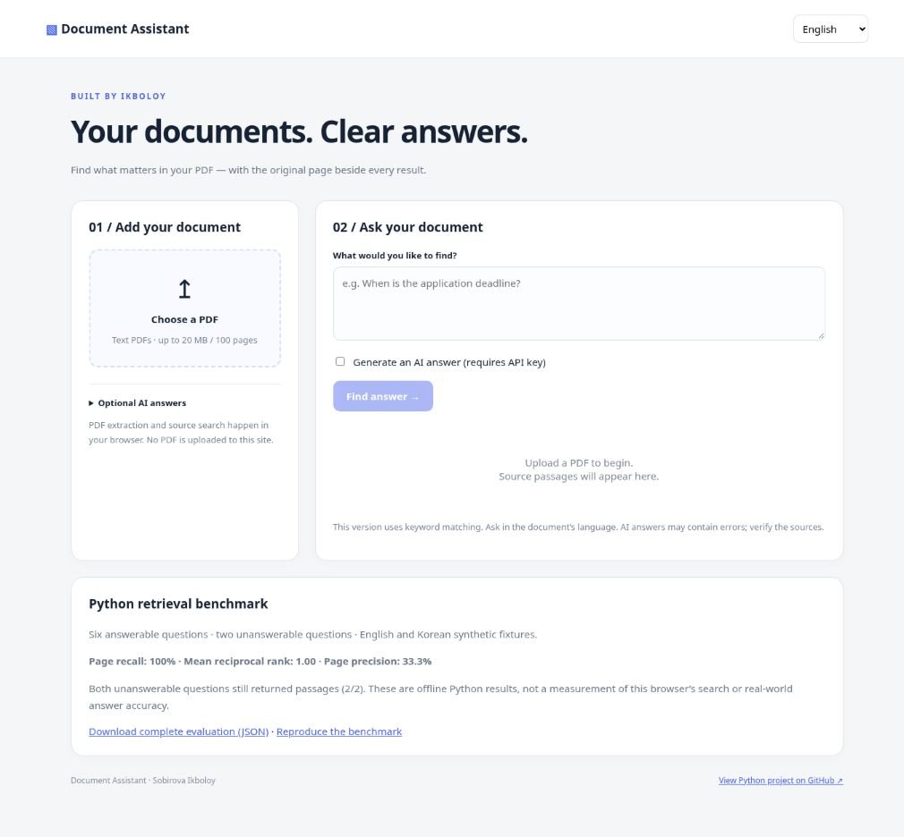

# Document Assistant · PDF retrieval with source evidence

[](https://github.com/Ikboloy/document-assistant/actions/workflows/tests.yml)

**Purpose:** help readers find answers in text PDFs while keeping original page evidence visible.



*Screenshot: local preview of the separately hosted browser adaptation, in its initial state. The Python Streamlit app in this repository has a different UI and an English/Korean interface. The browser adaptation adds English/Korean/Uzbek UI selection and uses a different lexical search implementation. It is owner-private, so it is not advertised as a public demo.*

**Start here:** [Run locally](#run-locally) · [Evaluation](#offline-retrieval-evaluation) · [Limitations](#privacy-and-limits)

A PDF question-answering portfolio project by **Sobirova Ikboloy**, Computer Engineering graduate of Keimyung University.

Upload a text-based PDF, find relevant passages, and optionally generate an English or Korean answer with page references. The first version deliberately uses an inspectable character n-gram TF-IDF retrieval baseline rather than claiming semantic understanding.

## Features

- English and Korean interface and answer language selection
- Page-preserving text extraction and overlapping chunks
- Local source search without an API key
- Optional OpenAI Responses API generation, with sources visible beside the answer
- Page-reference validation: missing or out-of-context references withhold the AI answer
- Download original source pages as PDF and answers with evidence as JSON
- Session-scoped results survive download reruns; replacing/removing a document clears results
- Docker packaging and automated core/UI workflow tests

## Run locally

Python 3.12 recommended. From this project folder:

```bash
python3 -m venv .venv
source .venv/bin/activate
pip install -r requirements.txt
streamlit run app.py
```

On Windows, activate with `.venv\Scripts\activate` instead. Open the local URL printed by Streamlit. Upload a PDF and ask a question using words from its text. For AI answers, enter your own API key in the sidebar and enable generation. The default model is `gpt-4.1-mini`; change it to a model available to your account. API use has separate billing.

```bash
python -m unittest discover -s tests -v
docker build -t document-assistant .
docker run --rm -p 8501:8501 document-assistant
```

## Example walkthrough

1. Upload an English handbook containing “Applications close on October 30.”
2. Ask “When do applications close?”
3. Review the returned source passage and original page number.
4. Enable AI generation to receive a natural-language answer; choosing Korean controls the answer language.
5. Download the source PDF pages to inspect the original layout, or save the answer and excerpts as JSON. Exported pages follow original order; their original numbers are listed in the filename.

For Korean PDFs, try a question such as `신청 마감일은 언제인가요?`. These are illustrative examples, not measured benchmark results.

## Architecture

PDF → page text → overlapping chunks → character TF-IDF ranking → top four passages → optional LLM answer.

`core.py` owns extraction, retrieval and generation; `app.py` owns the bilingual Streamlit UI. Tests cover page provenance, English/Korean ranking, unreadable PDFs and the API request contract. API calls are mocked in tests.

## Privacy and limits

Uploads are processed in memory by the application, with no app-level file persistence. Search stays local. If AI generation is enabled, the question and retrieved excerpts are sent to OpenAI with `store=False`; this does not promise zero provider retention. Never commit API keys or private documents. Shared deployments need authentication and rate limiting before accepting sensitive files.

- Maximum 20 MB and 100 pages; encrypted or image-only PDFs are unsupported.
- Layout extraction, tables and mixed reading order may be imperfect.
- Retrieval is lexical, not semantic; cross-language search is not supported in this version.
- Similarity scores are not confidence probabilities. Any nonzero match can appear.
- Citations in `[p. N]` format are checked against retrieved page numbers. This checks reference membership only, not factual correctness or support for every claim. Missing citations (including uncited abstentions) withhold the response; sources remain visible.
- The offline retrieval benchmark below measures a small synthetic fixture, not generated-answer accuracy or production readiness. The separately hosted browser adaptation is not a deployment of this Python source.

## Next steps

Add multilingual embeddings with an evaluated English/Korean query set, OCR, claim-level evidence validation, and retrieval metrics before introducing agents or MCP into the application itself. GitHub MCP is used to publish this project; it is not a runtime feature of the app.

## References

- [OpenAI Python SDK](https://github.com/openai/openai-python)
- [Streamlit](https://docs.streamlit.io/)
- [pypdf](https://pypdf.readthedocs.io/)
- [scikit-learn TF-IDF](https://scikit-learn.org/stable/modules/generated/sklearn.feature_extraction.text.TfidfVectorizer.html)

## Validation of this update

Run `python -m unittest discover -s tests -v` from the repository root. Thirteen tests cover retrieval, real generated PDF extraction and source-page export, missing/unknown references, no-evidence provider bypass, JSON export, Streamlit session/download workflows, and retrieval-evaluation arithmetic. UI workflows use Streamlit AppTest with a mocked uploader; provider responses are mocked. A live paid model call, browser visual review, and Docker execution were not performed for this update.

## Offline retrieval evaluation

Run `python evaluate.py` to print a reproducible JSON report without an API key. The hand-authored fixture contains six English/Korean source pages, six answerable questions and two unanswerable questions. It uses the existing lexical retriever unchanged.

The report includes page recall, page precision and reciprocal rank averaged across answerable questions. Repeated chunks from the same page count only once. `top_k_chunks` limits chunks before page deduplication. `unanswerable_retrieval_rate` is the fraction of unanswerable questions that still return passages; lower is better. This reveals false matches instead of treating them as correct answers.

This is a small synthetic smoke benchmark, not independent evaluation, real-world accuracy, multilingual semantic understanding or a test of generated answer correctness. Add independently labeled real documents before drawing quality conclusions. Three additional unit tests check metric arithmetic, duplicate handling, empty rankings and report structure.

Measured on this fixture with scikit-learn 1.8.0: mean page recall 1.00, mean reciprocal rank 1.00, mean page precision 0.333, and unanswerable retrieval rate 1.00 (2/2). The retriever ranks the expected page first for these six answerable queries but still returns unrelated passages, including for both unanswerable queries. This is a documented limitation, not evidence of reliable abstention.

## PostgreSQL + Hasura learning lab

See [local stack setup and exercises](docs/local-stack.md) for Docker Compose, a persistent document-title catalog, GraphQL examples and automated integration checks. The Streamlit app can now explicitly save, list and delete document titles through Hasura. Only titles and language are persisted; PDFs, questions and answers remain in memory. This is a single-user local lab, not a public multi-user deployment. AWS deployment and user authentication are future milestones.
